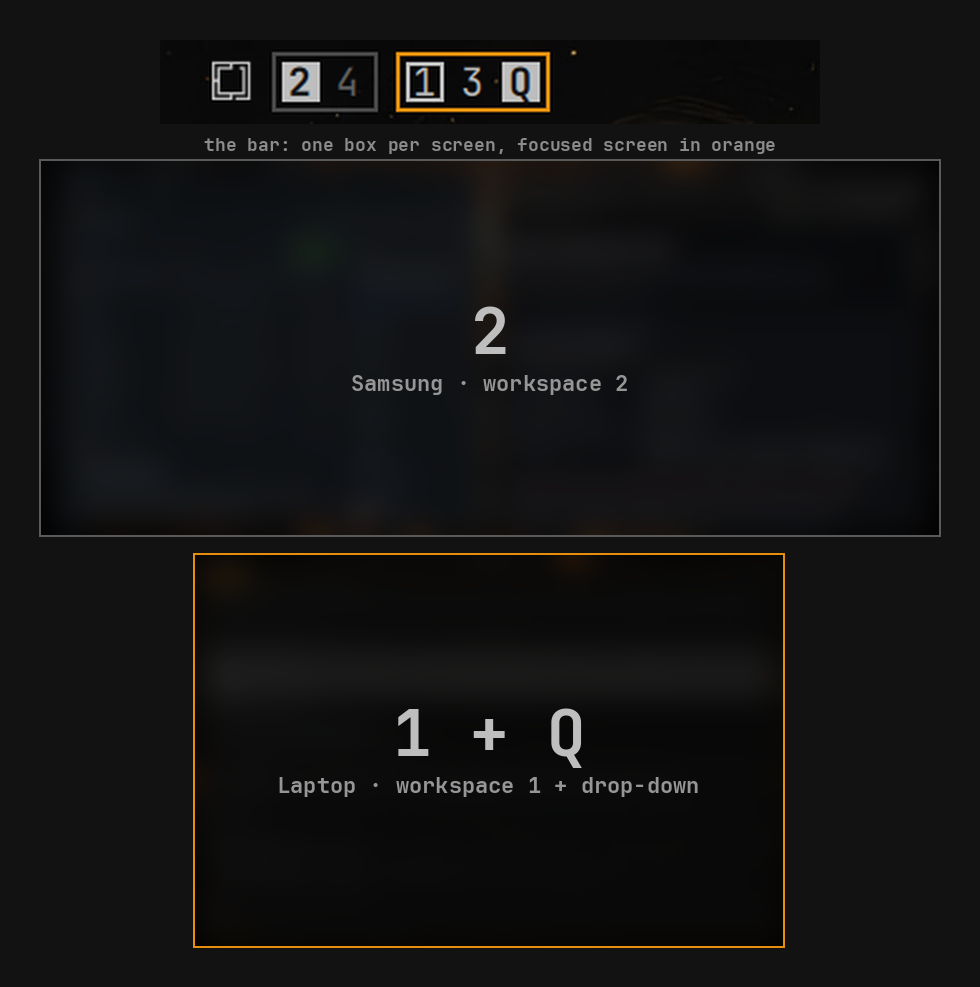

# Work Wonders

Which workspace every screen is showing, from one bar. Workspaces are grouped by monitor, and each screen's current workspace is highlighted.




Made for multi-monitor setups, where Omarchy's own workspace widget shows one row of numbers and you can't tell which screen is on which workspace.

## Features

- One group per monitor, in the order the screens are laid out: rows top to bottom, each row left to right.
- The workspace each screen is showing is drawn inverted, so with two screens you see both at a glance.
- The focused screen's group is outlined in your theme's accent colour.
- Empty workspaces are dimmed. Click any number to go there.
- Follows your workspace rules: a workspace you've assigned to a monitor sits in that monitor's group even before it exists, so empty slots stay clickable where they will open.
- A workspace you've moved to another screen shows under the screen it's on now.
- Special workspaces (scratchpad, a drop-down terminal) slide into the screen they open on, as a letter, drawn filled because they have focus. The workspace underneath keeps an outline. Click the letter to close it.
- With one monitor it looks like Omarchy's own widget: numbers 1 to 5 plus any other workspace in use, without the group border.
- Updates live as you switch, move workspaces, or plug monitors in and out.

## Requirements

- Omarchy with Omarchy Shell plugin support (tested with Omarchy 4 and Hyprland 0.56).

## Install

```bash
omarchy plugin add https://github.com/JamesForan/workwonders.git --enable
```

Then swap it in for the built-in workspaces widget, either by dragging widgets on the bar or in `~/.config/omarchy/shell.json`, by changing the `omarchy.workspaces` entry in `bar.layout` to:

```json
{ "id": "jamesforan.workwonders" }
```

The shell reloads `shell.json` on save.

## Settings

Add these to the widget's entry in `bar.layout`:

| Setting | Default | What it does |
| --- | --- | --- |
| `screens` | `"all"` | `"all"` shows every monitor in each bar. `"own"` shows only the monitor that bar is on, for setups with a bar on every screen. |
| `alwaysShow` | `5` without workspace rules, `0` with them | Numbered workspaces to show even when they don't exist yet. |
| `specials` | `"open"` | Special workspaces: `"open"` shows one only while it's open, on that screen; `"always"` keeps them listed on the screen they last opened on; `"hide"` never shows them. |
| `specialLabels` | first letter of the name | Letter (or icon) for each special workspace, by name. |

For example, on a bar drawn on every screen:

```json
{ "id": "jamesforan.workwonders", "screens": "own" }
```

Or, with a scratchpad and a quake-style drop-down terminal that live in special workspaces named `scratchpad` and `terminal`:

```json
{
  "id": "jamesforan.workwonders",
  "specials": "always",
  "specialLabels": { "scratchpad": "S", "terminal": "Q" }
}
```

## Assigning workspaces to monitors

Work Wonders reads Hyprland's workspace rules, so assigned workspaces show in the right group. In `~/.config/hypr/monitors.lua`:

```lua
hl.workspace_rule({ workspace = "1", monitor = "eDP-1" })
hl.workspace_rule({ workspace = "2", monitor = "desc:Samsung Electric Company SE790C" })
```

`desc:` matches the start of the monitor's description, as in Hyprland's own rules. `hyprctl monitors` lists both names and descriptions.

## Notes

- Omarchy draws the bar on every screen. With the default `"screens": "all"`, every bar shows every monitor. Use `"own"` if you'd rather each bar show only its own screen.
- This plugin runs inside the Omarchy Shell process. Review the source before installing any plugin.

## Remove

Put `omarchy.workspaces` back in `bar.layout`, then:

```bash
omarchy plugin remove jamesforan.workwonders
```

## Development

The repository root is the plugin folder:

- `manifest.json`: plugin manifest (a `bar-widget`).
- `WorkWonders.qml`: the widget. It reads `hyprctl -j monitors`, `workspaces` and `workspacerules` after each relevant Hyprland event.
- `WorkWondersModel.js`: which workspace goes in which group, and the monitor order. It has no Qt dependencies, so it runs under node.
- `tests/`: recorded `hyprctl` output for several monitor setups and the groups each should produce. `tests/run` checks them under node and never touches your session. After an intended output change, `tests/run --update` rewrites the expected files; review the diff before committing.

Validate with `omarchy plugin validate .` and `tests/run`. For local testing, copy `manifest.json`, `WorkWonders.qml` and `WorkWondersModel.js` to `~/.config/omarchy/plugins/jamesforan.workwonders/`, run `omarchy-shell shell rescanPlugins` and `omarchy plugin enable jamesforan.workwonders`. If an edit doesn't show up, restart the shell (`omarchy restart shell`).

## License

MIT
